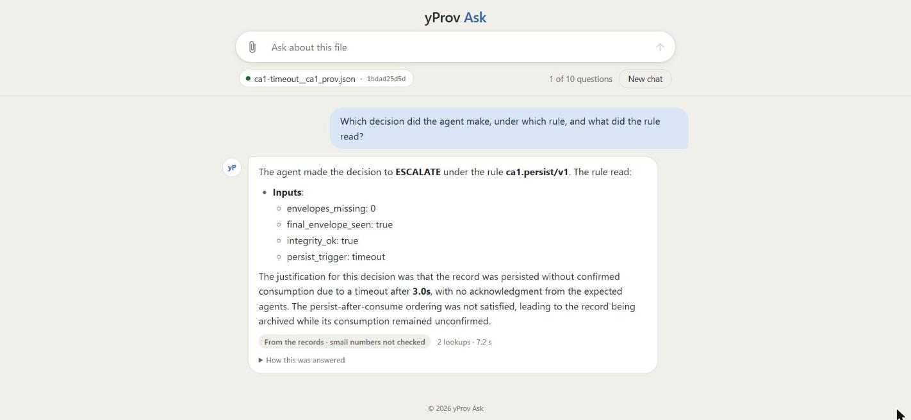
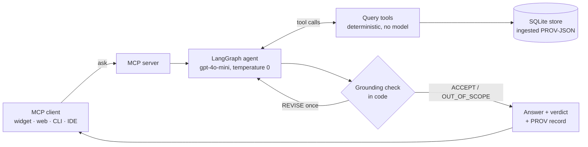

# yProv Ask

[](https://github.com/munyaradzi-zhou/yprov-ask/actions/workflows/ci.yml)


Ask questions in plain language about W3C PROV provenance files, and get answers that are
checked against the files before they are returned.



yProv Ask is an [MCP](https://modelcontextprotocol.io) server with a LangGraph agent behind
it. The agent can learn about a file only through deterministic query tools; every figure in
its answer is then checked in code against what those tools returned, and every answer is
written down as its own PROV record, so any verdict can be replayed and audited.

## Features

- **Grounded answers.** A code check (`qa.grounding/v3`) accepts an answer only when every
  figure in it was returned by a lookup, and in the role it was returned for; otherwise the
  agent is sent back once to revise.
- **Honest about scope.** Questions the records cannot answer are declined, not answered from
  the model's general knowledge.
- **Auditable.** Each answer carries a PROV record of the question, every tool call, the model
  call and the decision, with the rule inputs needed to replay the verdict.
- **Reads the yProv family.** yProv4ML training runs (including their metric CSVs),
  yProv4Agents decision records, and yProv4WfS, openEO, Ophidia and analytics4yprov workflow
  traces; any other PROV-JSON is read as plain PROV.
- **One server, several clients.** A browser widget for the
  [yProv Explorer](https://explorer.yprov.disi.unitn.it/), a web console, a terminal chat,
  and any MCP client (Claude Desktop, IDEs, scripts) over stdio or streamable HTTP.
- **Container ready.** A non-root Docker image with a health check and CORS configuration.

## How it works



## Quick start

Requires Python 3.11–3.13 and [uv](https://docs.astral.sh/uv/).

```bash
git clone https://github.com/munyaradzi-zhou/yprov-ask.git
cd yprov-ask
uv sync --extra dev
cp .env.example .env                 # add OPENAI_API_KEY for the agent

uv run yprov-ask ingest samples      # 35 sample documents
uv run yprov-ask docs                # list what was ingested
uv run yprov-ask ask "Which agent decisions in the faults collection were not ACCEPT?"
```

Only `ask` needs an API key; every query tool works without one.

## Usage

### Chat widget

```bash
YPROV_ASK_INGEST=samples uv run yprov-ask serve --http --port 8000
```

Open [http://127.0.0.1:8000/widget/](http://127.0.0.1:8000/widget/) (add `?theme=light` or `?theme=dark` to fix the theme),
attach a PROV-JSON file with the paper clip, and ask. The widget is a single dependency-free
web component that embeds in any page:

```html
<script src="https://your-host/widget/yprov-ask.js"></script>
<yprov-ask endpoint="https://your-host/mcp" theme="light" style="height: 600px"></yprov-ask>
```

A chat holds ten questions (`max-turns`); follow-ups see the earlier turns.

### Web console and terminal chat

```bash
uv run yprov-ask web     # http://127.0.0.1:8080/ : ask, browse documents, call tools by hand
uv run yprov-ask chat    # the same in the terminal
```

Both start the server over stdio, or connect to a running one with
`--server http://host:8000/mcp`.

### Any MCP client

For a stdio client such as Claude Desktop:

```json
{
  "mcpServers": {
    "provenance": {
      "command": "uv",
      "args": ["run", "--directory", "/path/to/yprov-ask", "yprov-ask", "serve"],
      "env": {
        "YPROV_ASK_INGEST": "/path/to/yprov-ask/samples",
        "OPENAI_API_KEY": "sk-..."
      }
    }
  }
}
```

Python clients of MCP SDK 2.3 connecting over HTTP must use `Client(url, mode="legacy")`;
the SDK's protocol probe fails against its own HTTP server.

### Docker

```bash
docker build --build-arg VERSION=0.1.0 -t yprov-ask:0.1.0 .
docker run --rm -p 8000:8000 -e OPENAI_API_KEY \
    -e YPROV_ASK_CORS=https://explorer.yprov.disi.unitn.it yprov-ask:0.1.0
```

The image serves MCP at `/mcp`, the widget at `/widget/`, and a liveness probe at `/healthz`.
It runs as an unprivileged user and writes only under `/tmp`.

## Configuration

Settings are read from the environment, or from a `.env` file in the working directory.

| Variable                  | Default                    | Purpose                                                        |
| ------------------------- | -------------------------- | -------------------------------------------------------------- |
| `OPENAI_API_KEY`        |                            | required for `ask` only                                      |
| `YPROV_ASK_MODEL`       | `gpt-4o-mini-2024-07-18` | chat model used by the agent                                   |
| `YPROV_ASK_DB`          | `provqa.sqlite`          | SQLite store                                                   |
| `YPROV_ASK_INGEST`      |                            | paths ingested at start-up, separated by the OS path separator |
| `YPROV_ASK_ROOTS`       | the ingest paths           | directories the `ingest` tool may read                       |
| `YPROV_ASK_RECORDS`     | `records`                | where answer records are written                               |
| `YPROV_ASK_CACHE`       | next to the records        | where uploaded and fetched files are kept                      |
| `YPROV_ASK_CORS`        |                            | browser origins allowed to call `/mcp`                       |
| `YPROV_ASK_STORE_HOSTS` |                            | hosts `store_get` and `open_file` may fetch from           |
| `YPROV_ASK_LOG`         | `INFO`                   | log level                                                      |

## MCP tools

| Tool                                     | Model | Purpose                                                                                                                     |
| ---------------------------------------- | ----- | --------------------------------------------------------------------------------------------------------------------------- |
| `ask`                                  | yes   | the agent's answer, verdict, tool calls and PROV record                                                                     |
| `list_documents`                       | no    | ingested files, their kind and collection                                                                                   |
| `describe_document`                    | no    | an overview of one file: agents, activities, parameters, metrics, decisions, workflow statistics and an attribute catalogue |
| `activity_stats`                       | no    | workflow tasks grouped by step, status, module, worker or any attribute                                                     |
| `count_values`                         | no    | every value of an attribute with its count                                                                                  |
| `search_nodes`                         | no    | find nodes by text, through a vocabulary that explains each match                                                           |
| `get_node`                             | no    | one node with all its attributes and relations                                                                              |
| `trace_lineage`                        | no    | walk the graph upstream or downstream                                                                                       |
| `metric_summary`, `metric_series`    | no    | logged metrics: summaries across runs, or the raw points                                                                    |
| `list_decisions`                       | no    | yProv4Agents decisions with their rule inputs                                                                               |
| `open_file`, `store_get`, `ingest` | no    | add a file by URL, from an allowed store host, or from an allowed directory                                                 |

Resources: `prov://documents` and `prov://documents/{doc_id}`.

## Development

```bash
uv sync --extra dev
uv run pre-commit install
uv run pytest                     # no API key needed: agent tests use a scripted model
uv run ruff check . && uv run ruff format --check .
```

Tests marked `llm` call the OpenAI API and are excluded in CI (`pytest -m "not llm"`). The
widget's rendering tests run under Node when it is installed.

```
yprov_ask/
  store.py          PROV-JSON and metric CSVs into SQLite
  tools.py          deterministic queries, the agent's only source of facts
  workflow.py       workflow-trace statistics
  vocabulary.py     user words mapped to the words files use
  agent.py          the LangGraph agent
  grounding.py      the figure and role checks, and the replayable rule
  record.py         each answer as a PROV-JSON record
  server.py         the MCP server
  widget.py, files.py, fetch.py, web.py, client.py, conversation.py
  static/           the web console and the <yprov-ask> widget
eval/               question banks, gold-answer code, runners and scorers
samples/            yProv4ML and yProv4Agents example records
tests/
```

## Acknowledgements

Built on the yProv provenance ecosystem of the
[HPCI Lab](https://github.com/HPCI-Lab), University of Trento.
